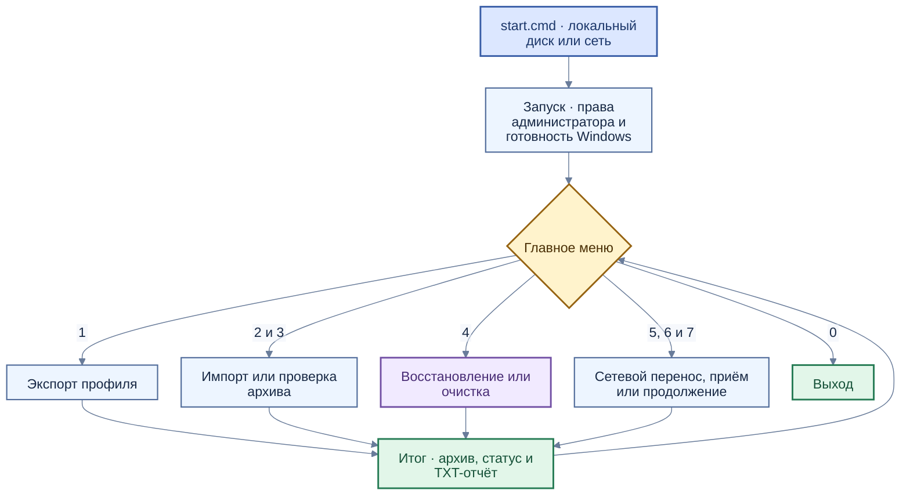
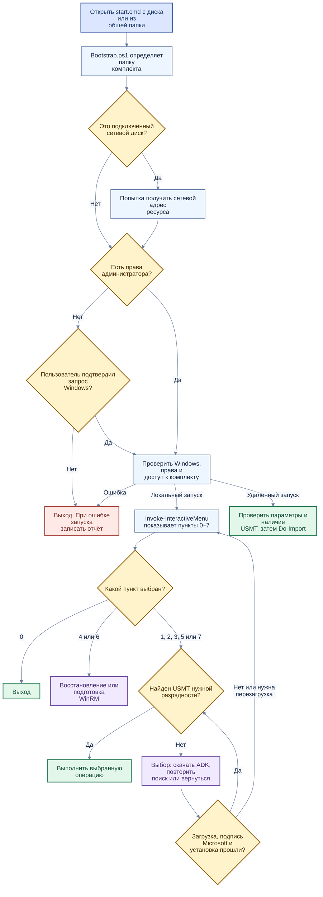
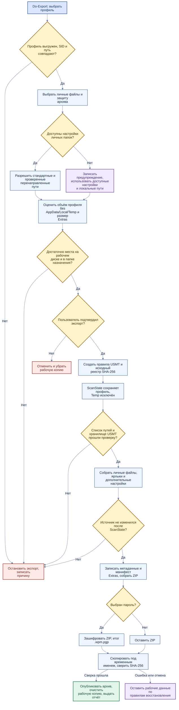
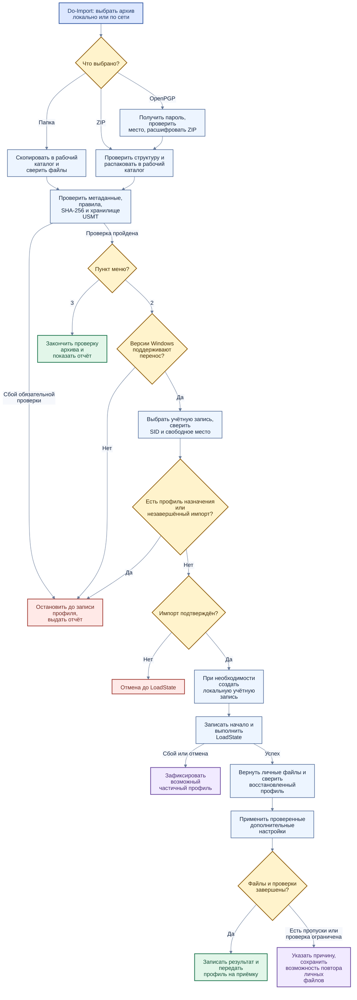
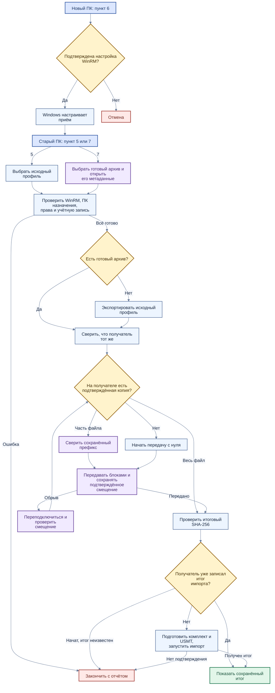
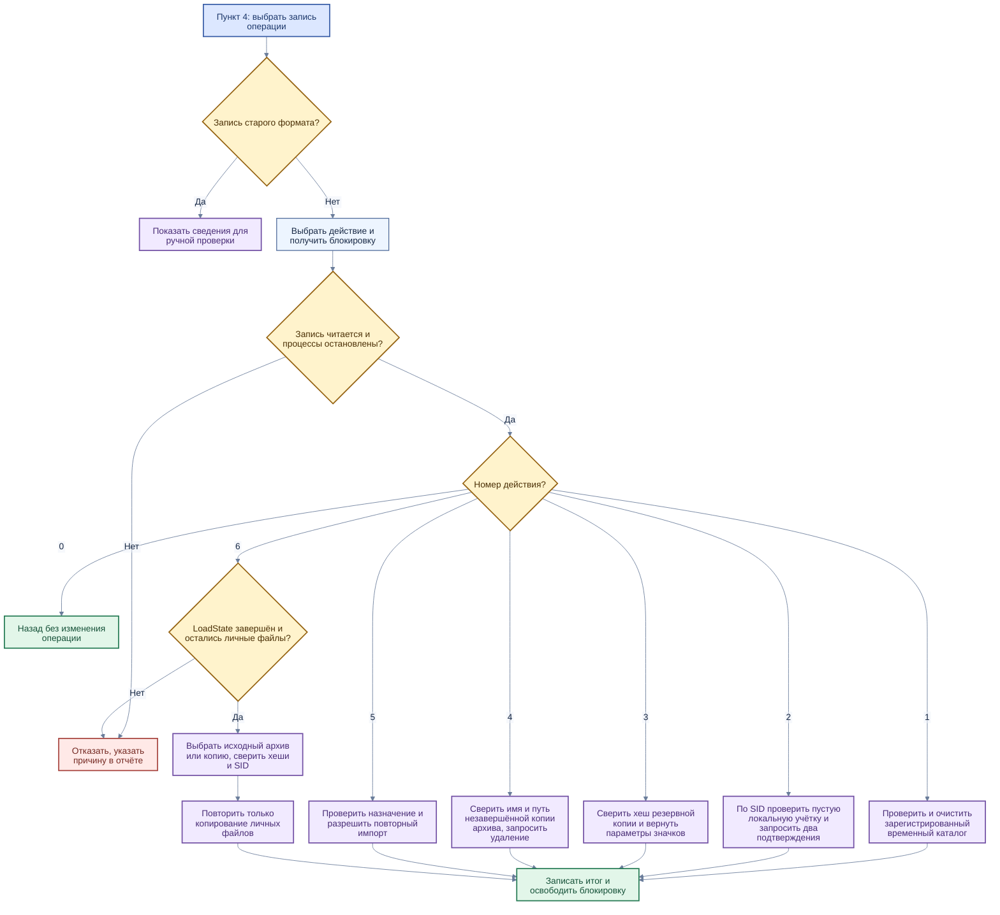
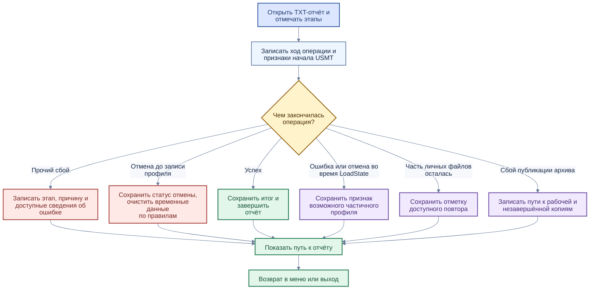

# Как работает WindowsProfileMigration v1.11.1

Профиль Windows принадлежит одному пользователю. В нём хранятся документы, рабочий стол и настройки. На исходном компьютере программа собирает профиль в архив. На целевом компьютере она проверяет архив и восстанавливает данные для выбранной учётной записи.

## Откуда и куда идут данные

На карте показано, куда ведёт каждый пункт меню и каким результатом заканчивается операция. Ниже можно перейти к подробной схеме и к функции, с которой начинается сценарий.

**Легенда**

| Обозначение | Что означает |
| --- | --- |
| 🟦 Синий прямоугольник | Вход в сценарий или действие программы |
| 🟨 Жёлтый ромб | Условие или выбор пользователя |
| 🟩 Зелёный прямоугольник | Итог, сохранённый архив или отчёт |
| 🟥 Красный прямоугольник | Ошибка или остановка |
| 🟪 Фиолетовый прямоугольник | Частичный результат, повтор или восстановление |



Откройте [FLOWCHART.html](FLOWCHART.html) из распакованного ZIP для просмотра этих же схем в браузере.

| Пункт | Сценарий | Точка входа |
| --- | --- | --- |
| Запуск | [Подготовка Windows и USMT](#запуск-и-подготовка) | [Bootstrap.ps1](Program/Bootstrap.ps1) · `Start-MigrationProcess` |
| 1 | [Экспорт](#экспорт-профиля) | [Export.ps1](Program/Export.ps1) · `Do-Export` |
| 2 и 3 | [Импорт и проверка архива](#проверка-и-импорт-архива) | [Import.ps1](Program/Import.ps1) · `Do-Import` |
| 4 | [Состояние, очистка и восстановление](#восстановление-и-очистка) | [Recovery.ps1](Program/Recovery.ps1) · `Show-RecoveryMenu` |
| 5, 6 и 7 | [Прямой перенос и возобновление](#прямой-перенос-по-сети) | [Network.ps1](Program/Network.ps1) · `Do-RemoteDeploy`, `Prepare-RemoteReceiver` |
| 0 и остановка | [Отмена, итог и отчёт](#отмена-итог-и-отчёт) | [MainMenu.ps1](Program/MainMenu.ps1) · `Invoke-InteractiveMenu` |

### Запуск и подготовка



[Usmt.ps1](Program/Usmt.ps1) реализует `Get-UsmtPath`, `Require-USMT` и установку ADK. Пункт 4 и подготовка WinRM доступны без USMT.

### Экспорт профиля



[Export.ps1](Program/Export.ps1) объединяет `New-ProfileOnlyRules`, `Invoke-ProfileScan` и `Save-ProfileScopeProof`. [UserFiles.ps1](Program/UserFiles.ps1) читает папки пользователя и копирует личные файлы.

### Проверка и импорт архива



[ArchiveSelection.ps1](Program/ArchiveSelection.ps1) находит архив. [Import.ps1](Program/Import.ps1) выполняет `Assert-ImportProfileUnused` и `Invoke-ProfileLoad`. [FileManifest.ps1](Program/FileManifest.ps1) сверяет контрольные файлы. Старые правила формата 7 принимаются только по известному SHA-256. Форматы 1–6 доступны для проверки, если их метаданные читаются.

### Прямой перенос по сети



[Network.ps1](Program/Network.ps1) использует `Send-RemoteArchive` и `Enter-RemoteMigration`. При несовпадении префикса, недостатке места или смене получателя передача останавливается. Если архив с паролем, пароль передаётся получателю по закрытому каналу. Сохранённый итог описывает полный, частичный или неподтверждённый результат.

### Восстановление и очистка



[Recovery.ps1](Program/Recovery.ps1) связывает меню с `Invoke-TrackedRecovery`. При выборе пункта 5 импорт запускается пользователем отдельно после подтверждения, а при выборе пункта 6 LoadState повторно не вызывается.

### Отмена, итог и отчёт



[Reporting.ps1](Program/Reporting.ps1) создаёт отчёт и пишет причину ошибки. [Recovery.ps1](Program/Recovery.ps1) атомарно обновляет запись состояния. По отчёту можно понять действие и причину остановки, по записи состояния - доступные операции восстановления.

## Что лежит в комплекте

```text
WindowsProfileMigration/
├── start.cmd                 Запускает программу
├── README.txt                Краткая инструкция по переносу
├── TECHNICAL.md              Схемы и техническое описание
├── FLOWCHART.html            Схемы для просмотра без интернета
├── Program/                  Код и библиотеки
│   ├── Bootstrap.ps1         Запрашивает права администратора
│   ├── ProfileMigration.ps1  Подключает части программы
│   ├── MainMenu.ps1          Вызывает действие по номеру из меню
│   ├── Export.ps1            Собирает профиль на исходном ПК
│   ├── Import.ps1            Проверяет и восстанавливает профиль
│   ├── Vendor/               Библиотека Bouncy Castle и её лицензия
│   └── …                     Вспомогательные файлы перечислены ниже
├── Reports/                  Итоговые отчёты
└── Backups/                  Архивы при сохранении рядом с программой
```

В репозитории также есть каталог `tests/` со сценариями проверок, `.github/workflows/` с настройками GitHub Actions, история версий и результаты испытаний. Для запуска на Windows достаточно распакованного комплекта.

## Какие файлы работают вместе

| Файлы в Program | За что отвечают |
| --- | --- |
| `Console.ps1`, `MainMenu.ps1` | Показывают варианты, читают номер и передают выбор нужному действию. |
| `Profiles.ps1`, `Export.ps1`, `Usmt.ps1` | Определяют владельца и состояние профиля, готовят правила отбора файлов и запускают USMT. |
| `ArchiveSelection.ps1`, `Archives.ps1`, `FileManifest.ps1` | Находят архив, проверяют имена и пути. В списке файлов записаны размеры и контрольные суммы SHA-256. Изменение файла можно обнаружить сравнением этих сумм. |
| `Encryption.ps1`, `OpenPgpArchive.cs` | Закрывает ZIP паролем и открывает его для проверки или импорта. До распаковки проверяется целостность защищённого файла. |
| `Import.ps1`, `Storage.ps1` | Проверяют свободное место, хранилище USMT и учётную запись назначения. Только потом запускают восстановление. |
| `Extras.ps1`, `Browsers.ps1`, `Desktop.ps1` | Обрабатывают дополнительные настройки, в том числе файлы браузеров, сетевые диски и расположение значков. |
| `UserFiles.ps1` | Собирает выбранные «Документы» и «Загрузки», а также файлы ярлыков рабочего стола. На приёмнике возвращает их в папки целевого пользователя. |
| `Network.ps1` | Передаёт архив блоками. После обрыва сверяет уже доставленную часть, перед импортом проверяет SHA-256 всего файла. |
| `Recovery.ps1`, `Reporting.ps1` | Запоминают пройденные этапы и пишут отчёт. Если выполнение LoadState прервалось, пункт 4 помогает выяснить состояние операции перед повтором. |

## Что сохраняется в архиве

- `metadata.json` указывает исходный профиль, версию формата и данные для проверок. Windows различает учётные записи по **SID**. Это постоянный идентификатор, который программа сверяет при выборе профиля.
- `Store/` содержит хранилище USMT. `Rules/` хранит правила отбора. `Validation/` содержит список обработанных путей и контрольные суммы.
- `Extras/` содержит дополнительные пользовательские данные. Можно включить отдельную копию локальных файлов и подпапок из «Документов» и «Загрузок». Программа учитывает папки внутри профиля и отдельные локальные или сетевые папки, если доступен точный путь и владельцем является выбранный пользователь. При недоступности программа покажет локальный путь для запасной копии. Для облачной папки файлы должны быть доступны на диске. Если при восстановлении отдельной копии уже существует файл с тем же именем и другим содержимым, перенесённая копия сохраняется отдельно.
- Ярлыки рабочего стола `.lnk`, `.url`, `.rdp` и `.website` переносятся автоматически. Например, для ярлыка на `\\server\share\plan.xlsx` архив хранит сам ярлык. После восстановления он по-прежнему ведёт на тот же сетевой ресурс.

При проверке архивов формата 7 принимаются текущие и прежние правила ProfileOnly.xml с известными SHA-256. Новые архивы исключают временную папку профиля из расчёта места и переноса. При выборе защиты библиотека Bouncy Castle шифрует весь ZIP в формате OpenPGP с AES-256. Получается файл `.wpm.pgp`. При экспорте пароль вводится дважды. Для открытия файла потребуется пароль архива. Пароль новой локальной учётной записи используется отдельно для входа в Windows. Перед расшифровкой программа проверяет место на рабочем диске. Перед импортом программа требует место для самого профиля и предупреждает об объёме возможных дополнительных копий. Совпадающие файлы пропускаются. Для записи нового файла проверяется свободное место в его фактической папке. Сведения о пропусках при экспорте сохраняются в архиве и отображаются при проверке и импорте.

## Закрытие окна

`start.cmd` задаёт локальную рабочую папку для загрузчика. Отчёты и резервные копии по-прежнему сохраняются по путям, заданным в комплекте или выбранным в меню. Если консоль уже повышена, загрузчик открывает меню в том же процессе и передаёт код выхода обратно в `cmd`. При запросе UAC исходный загрузчик завершается сразу после запуска окна администратора. Пункт 0 завершает программу без дополнительного ожидания ввода.

## Где искать результат

При локальном экспорте готовый архив сохраняется в выбранной папке. По умолчанию это `Backups/`. Путь к итоговому TXT программа показывает на экране. Обычно отчёт находится в `Reports/`. Если часть личных файлов осталась невосстановленной, пункт 4 → 6 предлагает исходный архив или другую его копию. Программа сверяет SHA-256 метаданных и манифеста, затем повторяет копирование для того же SID. По SHA-256 программа пропускает совпадающие файлы. Закрытые рабочие копии и записи о незавершённых операциях хранятся в `%ProgramData%\WindowsProfileMigration-Work`. Пока процесс USMT работает, журнал блокирует очистку его временных файлов. При прямом сетевом переносе получатель записывает итог для отправителя. При частичном результате отчёт указывает причину и расположение архива на целевом ПК. Если контрольный список пуст и пропусков по другим проверкам нет, на исходном ПК отображается «Полнота переноса не подтверждена».

Автор проекта: Arhivater.

## Отчёт и прогресс

- `Reporting.ps1` пишет итоговый TXT с отметками начала и завершения этапов, временем работы, средой и идентификатором отчёта. При исключении сохраняются файл, строка, код HRESULT и код Windows, если он доступен.
- Общий индикатор считает завершённые шаги. Архив, OpenPGP, SHA-256 и передача по сети показывают байты. Обработка папок, файлов и настроек использует известное число объектов. В сетевой передаче учитываются только байты, подтверждённые получателем.
- `ScanState` и `LoadState` показывают проценты из журнала USMT. При подготовке зависимостей загрузка показывает байты. При неизвестном объёме и ожидании внешнего процесса видны текущий этап, а при наличии данных - счётчики или время.
- После сбоя сначала найдите последнюю строку «ЭТАП НАЧАТ». Она помогает определить, где остановилась операция. В сетевом сценарии особенно важны шаг передачи, подтверждённое смещение и итог на получателе. Перед публикацией отчёта проверьте имена и пути.

## Проверки сборки

При запуске на Windows распакуйте весь ZIP и откройте `start.cmd`. Результаты автоматических проверок и стенда публикуются вместе с версией комплекта. [Скачать ZIP](https://raw.githubusercontent.com/Arhivater/WindowsProfileMigration/release/v1.11.1/dist/WindowsProfileMigration_v1.11.1.zip) · [Прогоны GitHub Actions](https://github.com/Arhivater/WindowsProfileMigration/actions?query=branch%3Arelease%2Fv1.11.1)
